<picture>
  <source media="(prefers-color-scheme: dark) and (max-width: 600px)" srcset="./assets/banner-dark-narrow.svg">
  <source media="(prefers-color-scheme: light) and (max-width: 600px)" srcset="./assets/banner-light-narrow.svg">
  <source media="(prefers-color-scheme: dark)" srcset="./assets/banner-dark.svg">
  
</picture>

I'm a full-stack developer at [Hisoft](https://github.com/hisoft-br) / Podtech in Joinville, Santa Catarina, Brazil. My day-to-day is **Acolher**, a social-assistance management platform used by Brazilian municipalities, and I work on both halves of it: the Laravel API and the Nuxt web app.

Some of what I've shipped on Acolher:

- Video calls between staff in the browser, with group calls and a floating call window, built on LiveKit, alongside real-time chat.
- Data scoping across multiple municipalities.
- A hardened audit trail and LGPD-minded cleanup of personal data.
- Scheduling, PDF and XLSX reports, accessibility work, and a UI in Portuguese, English and Spanish.
- A typecheck gate in CI with a ratcheting baseline, so the error count can only go down.

I work with AI coding agents in a workflow where each change is planned, reviewed and QA'd.

## Stack

<picture>
  <source media="(prefers-color-scheme: dark) and (max-width: 600px)" srcset="./assets/stack-dark-narrow.svg">
  <source media="(prefers-color-scheme: light) and (max-width: 600px)" srcset="./assets/stack-light-narrow.svg">
  <source media="(prefers-color-scheme: dark)" srcset="./assets/stack-dark.svg">
  
</picture>

## Contributions

<picture>
  <source media="(prefers-color-scheme: dark)" srcset="https://raw.githubusercontent.com/EduardoSchelbauer/EduardoSchelbauer/output/snake-dark.svg">
  
</picture>

## Elsewhere

[LinkedIn](https://www.linkedin.com/in/eduardo-treichel-schelbauer-b39463227/) · [eduardo.schelbauer5@gmail.com](mailto:eduardo.schelbauer5@gmail.com)
